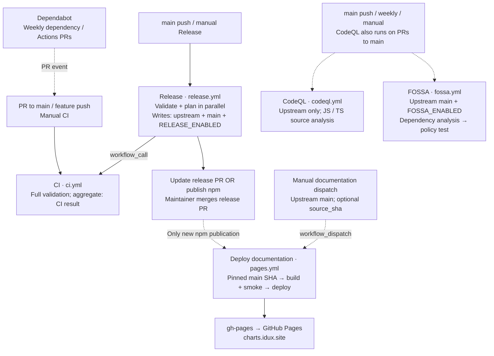
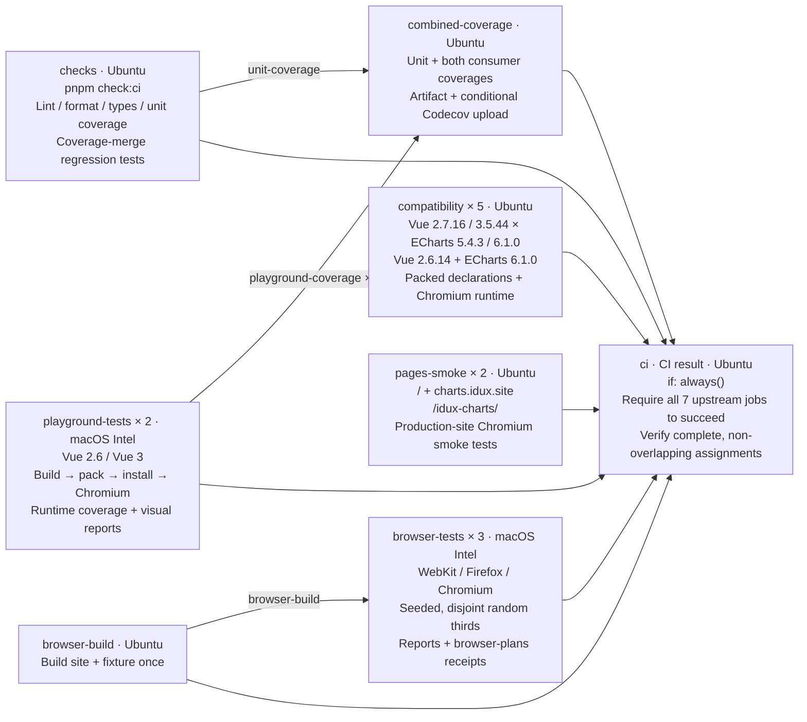
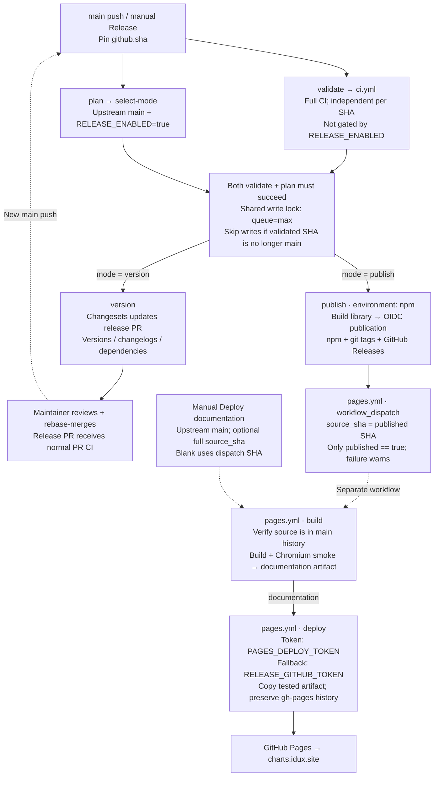

# Pipeline map

English | [简体中文](PIPELINES.zh.md)

The diagrams describe repository configuration; workflow YAML is authoritative. Release setup: [RELEASING.md](RELEASING.md). Coverage and security: [OPEN_SOURCE.md](OPEN_SOURCE.md).

## Triggers and execution conditions

| Workflow                                    | Trigger                                                       | Execution conditions                                                                                                                                    |
| ------------------------------------------- | ------------------------------------------------------------- | ------------------------------------------------------------------------------------------------------------------------------------------------------- |
| [CI](workflows/ci.yml)                      | PR targeting main; feature-branch push; manual; reusable call | Push excludes main, `changesets-ghcommit-temp/**`, `changeset-release/**`, `dependabot/**`. Release calls CI for main                                   |
| [Release](workflows/release.yml)            | main push; manual                                             | Validation always runs. Planning requires `IDuxFE/idux-charts`, main and `RELEASE_ENABLED=true`; writes also require successful validation and planning |
| [Deploy documentation](workflows/pages.yml) | Manual; dispatch after new npm packages are published         | Upstream main only. Optional `source_sha` must be a full SHA in main history; blank uses the dispatch SHA                                               |
| [CodeQL](workflows/codeql.yml)              | PR targeting main; main push; Monday 02:23 UTC; manual        | Upstream only                                                                                                                                           |
| [FOSSA](workflows/fossa.yml)                | main push; Monday 02:43 UTC; manual                           | Upstream main, `FOSSA_ENABLED=true`; needs `FOSSA_API_KEY`                                                                                              |

Weekly scans run Monday at 10:23 / 10:43 Asia/Shanghai. [Dependabot](dependabot.yml) separately creates weekly update PRs; those PRs trigger CI. GitHub Pages runs its platform deployment after the `gh-pages` push. Neither is an additional repository workflow file.

## CI dependencies

- Independent roots run in parallel. `CI result` directly requires all seven upstream job IDs and every matrix child to succeed, then verifies complete, non-overlapping browser assignments.
- Browser cases are randomly partitioned across three browsers using the run ID seed. Each case is assigned to one browser; `pnpm test:e2e:full` runs every case in every browser.
- Combined code coverage merges unit coverage and both Playground consumers. Browser assignment receipts are separate from code coverage.
- Matrices use `fail-fast: false`. Superseded PR / feature runs may be cancelled; main validation is independent per SHA. Reports and artifacts are retained for seven days.

## Release and deployment

Validation and planning run in parallel. Versioning and publication share a write lock (`queue: max`) and skip writes if their validated SHA is no longer main. Maintainers merge release PRs.

Only a successful **new-package** publication dispatches documentation deployment. Normal merges and release-PR updates do not deploy. Documentation uses the published SHA, builds and tests its own artifact, and can be retried independently. Dispatch failure warns without failing the successful npm publication.

## Maintenance entry points

| Symptom / change                          | Inspect                                                                                                                                                                                   |
| ----------------------------------------- | ----------------------------------------------------------------------------------------------------------------------------------------------------------------------------------------- |
| Triggers, runners, matrices, dependencies | `workflows/*.yml`; update `ci.needs` when adding a CI job                                                                                                                                 |
| Install / canvas / cache                  | [setup action](actions/setup/action.yml), [ci-timing.mjs](../scripts/ci-timing.mjs)                                                                                                       |
| Browser assignment / missing receipts     | [partition runner](../scripts/e2e-ci.mjs), [partitioner](../scripts/e2e-partition.mjs), [verifier](../scripts/e2e-verify-plans.mjs), [reports action](actions/browser-reports/action.yml) |
| Coverage / consumer compatibility         | [coverage merge](../scripts/merge-coverage.mjs), [Playground preparation](../scripts/prepare-playgrounds.mjs), [declaration tests](../scripts/test-declarations.mjs)                      |
| npm succeeded, site unchanged             | Release dispatch → Deploy documentation build / deploy → platform Pages deployment                                                                                                        |

When workflows change, update the Mermaid diagrams and trigger conditions in both language versions.
