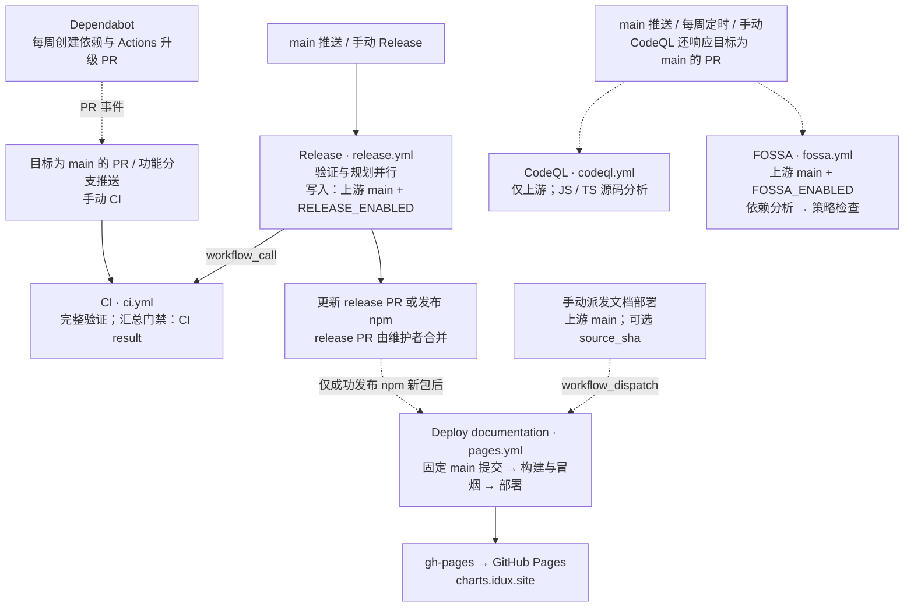
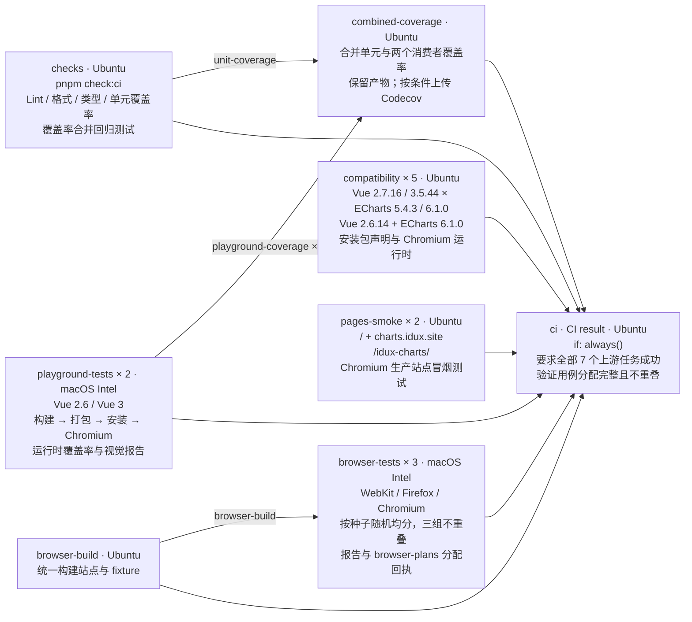
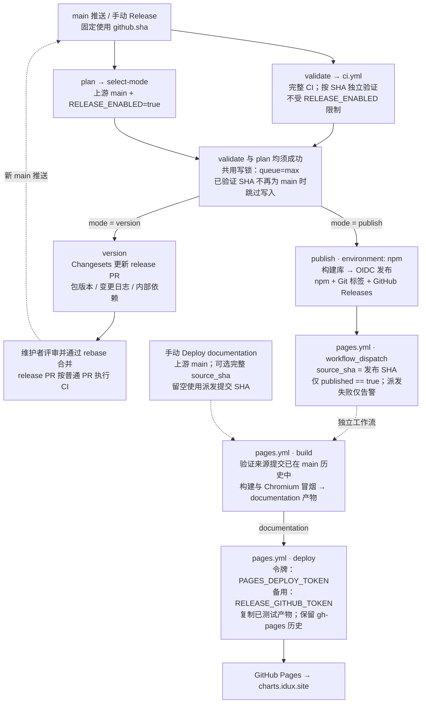

# 流水线地图

[English](PIPELINES.md) | 简体中文

图示说明仓库配置，执行逻辑以工作流 YAML 为准。发布配置见 [RELEASING.zh.md](RELEASING.zh.md)，覆盖率与安全集成见 [OPEN_SOURCE.zh.md](OPEN_SOURCE.zh.md)。

## 触发条件与执行边界

| 工作流                                      | 触发入口                                             | 执行条件                                                                                                        |
| ------------------------------------------- | ---------------------------------------------------- | --------------------------------------------------------------------------------------------------------------- |
| [CI](workflows/ci.yml)                      | 目标为 main 的 PR；功能分支推送；手动；复用调用      | push 排除 main、`changesets-ghcommit-temp/**`、`changeset-release/**`、`dependabot/**`；main 由 Release 调用 CI |
| [Release](workflows/release.yml)            | main 推送；手动                                      | 验证始终执行；规划要求 `IDuxFE/idux-charts`、main、`RELEASE_ENABLED=true`；写操作还要求验证与规划成功           |
| [Deploy documentation](workflows/pages.yml) | 手动；npm 新包发布成功后派发                         | 仅上游 main；可选 `source_sha` 须为 main 历史中的完整 SHA，留空使用派发提交 SHA                                 |
| [CodeQL](workflows/codeql.yml)              | 目标为 main 的 PR；main 推送；每周一 02:23 UTC；手动 | 仅上游仓库                                                                                                      |
| [FOSSA](workflows/fossa.yml)                | main 推送；每周一 02:43 UTC；手动                    | 上游 main、`FOSSA_ENABLED=true`；需要 `FOSSA_API_KEY`                                                           |

定时扫描对应北京时间每周一 10:23 / 10:43。[Dependabot](dependabot.yml) 独立创建每周升级 PR，由 PR 触发 CI。`gh-pages` 推送后，GitHub Pages 执行平台部署；二者都不是额外的仓库工作流文件。

## CI 任务依赖

- 无依赖入口并行运行。`CI result` 直接依赖全部七个上游 job ID，要求每个矩阵子任务成功，再验证浏览器用例分配完整且不重叠。
- 浏览器用例以 run ID 为种子随机分成三组，每个用例分配给一个浏览器；`pnpm test:e2e:full` 执行全浏览器全量回归。
- 综合代码覆盖率来自单元测试与两个 Playground 消费者；浏览器分配回执与代码覆盖率分别处理。
- 矩阵使用 `fail-fast: false`。PR / 功能分支可取消旧运行，main 按 SHA 独立验证；报告与产物保留七天。

## 发布与文档部署

验证与规划并行。版本更新与 npm 发布共用写锁（`queue: max`），写前确认已验证 SHA 仍为 main，过时则跳过。release PR 由维护者合并。

仅成功发布**新包**后派发文档部署，普通合并或更新 release PR 不部署。文档固定使用发布 SHA，独立构建、测试产物，可单独重试。派发失败仅告警，不改变 npm 发布成功结果。

## 维护入口

| 问题 / 变更                  | 优先查看                                                                                                                                                                    |
| ---------------------------- | --------------------------------------------------------------------------------------------------------------------------------------------------------------------------- |
| 触发条件、runner、矩阵、依赖 | `workflows/*.yml`；新增 CI job 时同步 `ci.needs`                                                                                                                            |
| 安装、canvas、缓存           | [setup action](actions/setup/action.yml)、[ci-timing.mjs](../scripts/ci-timing.mjs)                                                                                         |
| 分片遗漏、重复或缺少回执     | [分片执行](../scripts/e2e-ci.mjs)、[分配算法](../scripts/e2e-partition.mjs)、[回执验证](../scripts/e2e-verify-plans.mjs)、[报告 action](actions/browser-reports/action.yml) |
| 覆盖率、消费者兼容性         | [覆盖率合并](../scripts/merge-coverage.mjs)、[Playground 准备](../scripts/prepare-playgrounds.mjs)、[声明测试](../scripts/test-declarations.mjs)                            |
| npm 成功但站点未更新         | Release 派发 → Deploy documentation 构建与部署 → 平台 Pages 部署                                                                                                            |

工作流变更时，同步更新本页与英文版的 Mermaid 图和触发条件。
