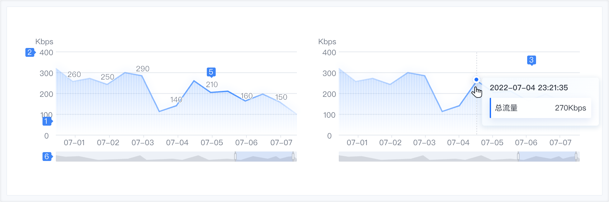
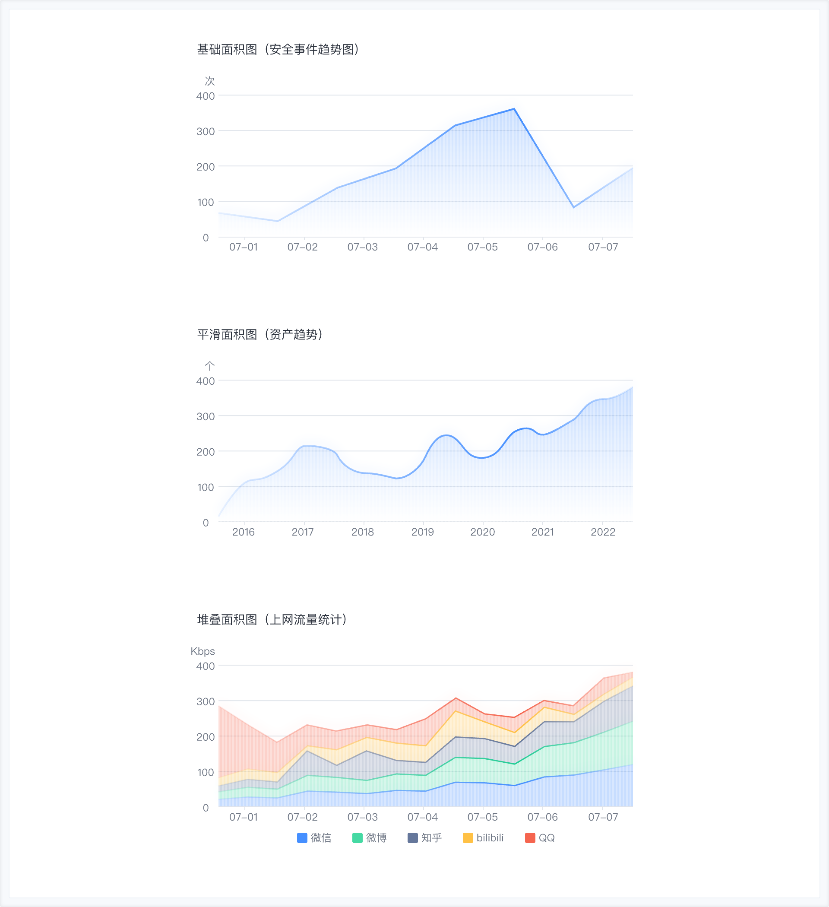
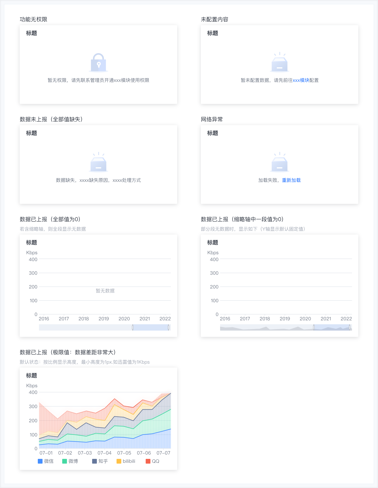
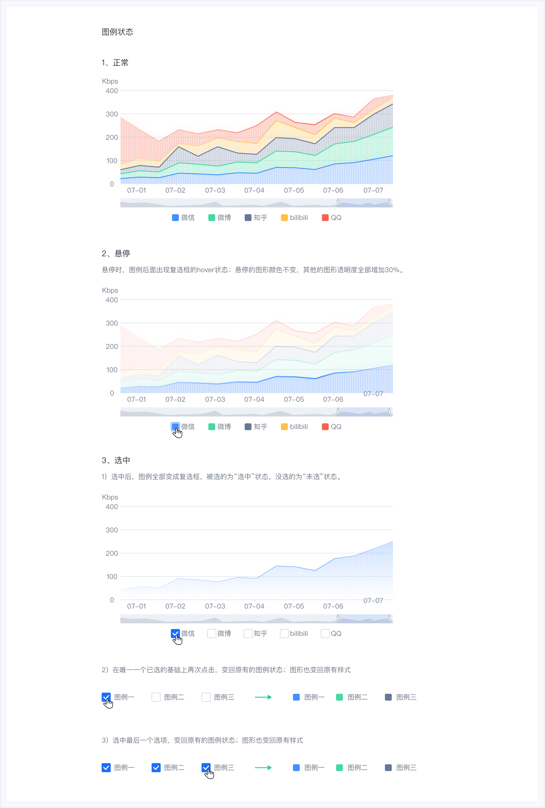

### 使用场景

面积图是在折线图基础上形成的，将折线与自变量坐标轴之间的区域使用颜色填充，这样的填充区域称为面积。颜色填充可以更好地突出趋势信息。需要注意的是，颜色要带有一定的透明度；在有重叠关系的场景下，透明度能增加相互遮盖的信息的可见度。

### 组件构成

| 序号 | 名称             | 说明                                                                                                 |
| ---- | ---------------- | ---------------------------------------------------------------------------------------------------- |
| 1    | 图形             | 连接各个数据点的线，以及线与自变量坐标轴之间使用半透明颜色填充的区域。                               |
| 2    | 坐标轴           | X 轴通常为时间，Y 轴通常为数据。                                                                     |
| 3    | 提示信息         | 当鼠标悬停在图形上时，以提示框的形式展示该点的数据，帮助用户快速获取图形的关键数据。                 |
| 4    | 图例（可选）     | 用于解释图表中的分类维度信息，本示例无需展示。                                                       |
| 5    | 数据标注（可选） | 对当前的一组数据进行内容标注。                                                                       |
| 6    | 缩略轴（可选）   | 可以缩小以宏观查看数据全貌，也可以放大以微观查看数据片断，同时还可以拖拽观察数据在一定区间内的演变。 |

### 组件类型

#### 基础型

#### 图表参考线

在图表上增加参考线，帮助用户更加直观地读取图表信息。

### 异常情况说明

| 异常情况                             | 展示与处理说明                                                                    |
| ------------------------------------ | --------------------------------------------------------------------------------- |
| 功能无权限                           | 展示无权限提示：“暂无权限，请先联系管理员开通 xxx 模块使用权限”。                 |
| 未配置内容                           | 展示未配置提示：“暂未配置数据，请先前往 xxx 模块配置”，并提供前往对应模块的入口。 |
| 数据未上报（全部值缺失）             | 展示数据缺失提示，说明缺失原因和处理方式。                                        |
| 网络异常                             | 展示“加载失败”，并提供“重新加载”操作。                                            |
| 数据已上报（全部值为 0）             | 保留坐标轴，在图表中展示“暂无数据”；若含缩略轴，则全段显示无数据。                |
| 数据已上报（缩略轴中一段值为 0）     | 所选区间不绘制面积图，Y 轴显示默认固定值；缩略轴保留其他区间的数据概览。          |
| 数据已上报（极限值：数据差距非常大） | 默认按比例显示高度，最小高度为 1px，保证极小值仍可见。                            |

### 组件状态

#### 图例间距

图例图形与文字的间距根据图例数量调整：

| 图例数量        | 图形与文字间距 |
| --------------- | -------------- |
| 小于或等于 3 个 | 8px            |
| 大于 3 个       | 4px            |

#### 图例状态

| 状态 | 展示与交互说明                                                                       |
| ---- | ------------------------------------------------------------------------------------ |
| 正常 | 图例使用对应系列的颜色，图形保持正常样式。                                           |
| 悬停 | 图例图形出现复选框的悬停状态；对应图形颜色不变，其他图形的透明度增加 30%。           |
| 选中 | 图例全部变成复选框，被选中的为“选中”状态，未选中的为“未选”状态；图表展示选中的系列。 |

在仅有一个图例被选中的情况下，再次点击该图例，恢复原有的图例状态和图形样式。选中最后一个未选中的图例，使所有图例均被选中时，也恢复原有的图例状态和图形样式。

