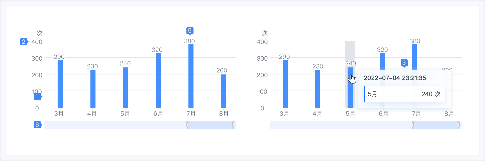
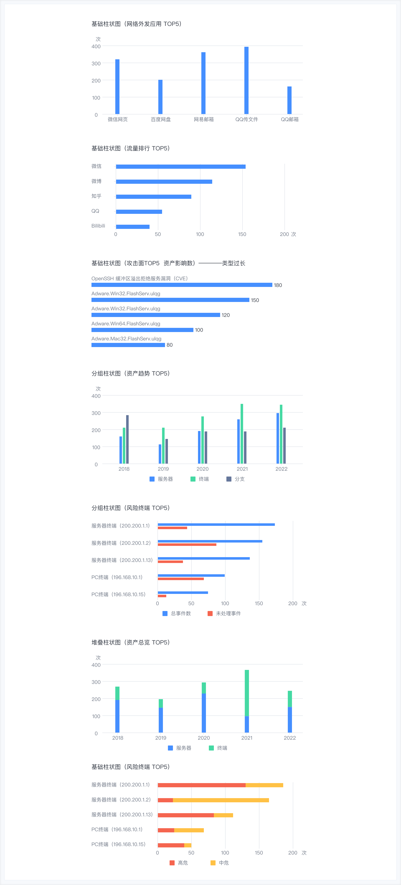
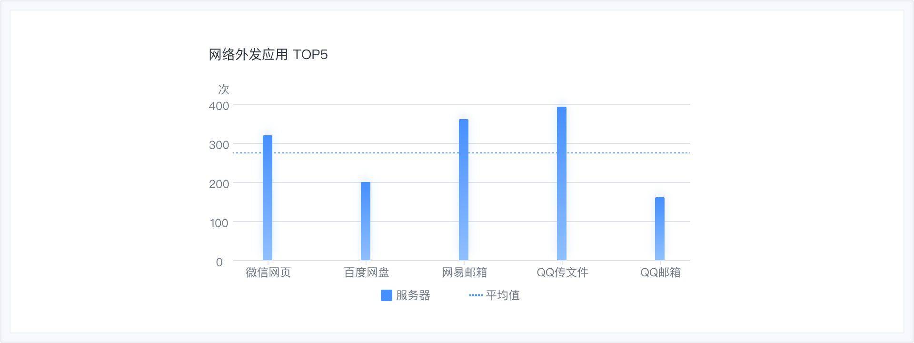
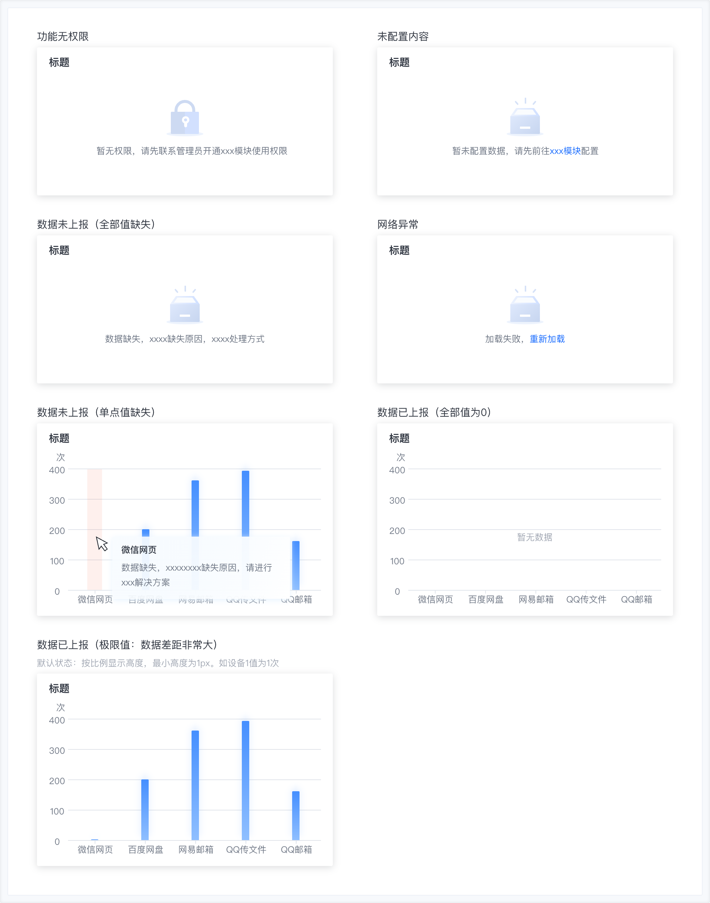

### 使用场景

柱状图借助自身高度，能够较清晰地反映数据之间的差异性，一般会用作不同角色间的对比，同时也可用来反映变化趋势。通常来说，柱状图的横轴更多会展示时间维度，用户会习惯性地认为存在时间趋势。

分类数据不宜过多，建议不超过 20 条；如有多组分类数据，建议不超过 10 组。

### 组件构成

| 序号 | 名称             | 说明                                                                                                 |
| ---- | ---------------- | ---------------------------------------------------------------------------------------------------- |
| 1    | 图形             | 各个数据点由柱状图形组成。                                                                           |
| 2    | 坐标轴           | X 轴通常为分类，Y 轴通常为数据。                                                                     |
| 3    | 提示信息         | 当鼠标悬停在图形上时，以提示框的形式展示该点的数据，帮助用户快速获取图形的关键数据。                 |
| 4    | 图例（可选）     | 用于解释图表中的分类维度信息。                                                                       |
| 5    | 数据标注（可选） | 对当前的一组数据进行内容标注。                                                                       |
| 6    | 缩略轴（可选）   | 可以缩小以宏观查看数据全貌，也可以放大以微观查看数据片断，同时还可以拖拽观察数据在一定区间内的演变。 |

### 组件类型

#### 基础型

#### 图表参考线

在图表上增加参考线，帮助用户更加直观地读取图表信息。

### 异常情况说明

| 异常情况                             | 展示与处理说明                                                                           |
| ------------------------------------ | ---------------------------------------------------------------------------------------- |
| 功能无权限                           | 展示无权限提示：“暂无权限，请先联系管理员开通 xxx 模块使用权限”。                        |
| 未配置内容                           | 展示未配置提示：“暂未配置数据，请先前往 xxx 模块配置”，并提供前往对应模块的入口。        |
| 数据未上报（全部值缺失）             | 展示数据缺失提示，说明缺失原因和处理方式。                                               |
| 网络异常                             | 展示“加载失败”，并提供“重新加载”操作。                                                   |
| 数据未上报（单点值缺失）             | 保留坐标轴和其他分类数据，缺失分类不绘制柱体；悬停时通过提示信息说明缺失原因及解决方案。 |
| 数据已上报（全部值为 0）             | 保留坐标轴和分类标签，不绘制柱体，在图表中展示“暂无数据”。                               |
| 数据已上报（极限值：数据差距非常大） | 默认按比例显示柱体高度，最小高度为 1px，保证极小值仍可见。                               |

### 与其他图表的对比

#### 对比折线图、饼图

1. 柱状图主要用于多个分类间的数据（大小、数值）的对比。
2. 折线图主要用于展示连续数值（例如时间）或者有序分类的变化趋势。
3. 饼图主要展示分类之间的占比情况。

#### 对比南丁格尔图（玫瑰图）

1. 南丁格尔图（玫瑰图）通过半径的大小来对比数据。
2. 柱状图根据矩形的长度来对比数据。

### 相关资料

设计方案：[折线图](./line)、[饼图](./pie)、[南丁格尔图（玫瑰图）](./pie)。

