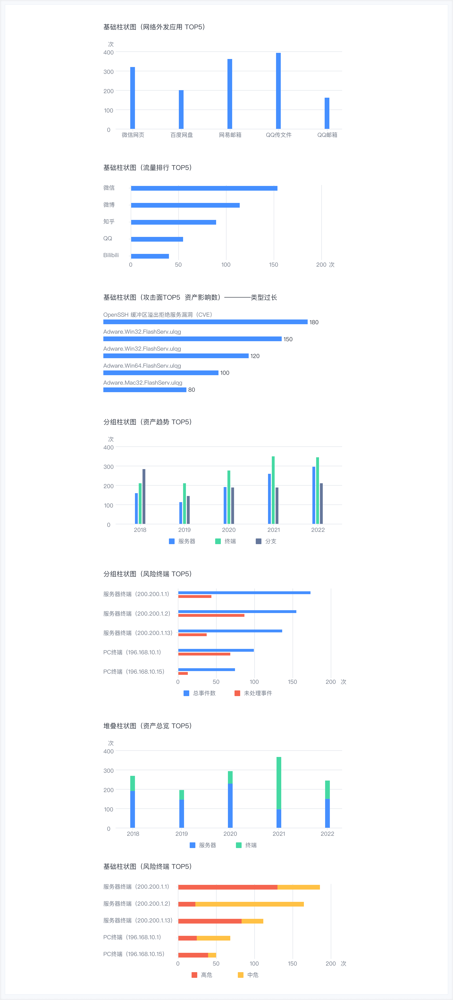

### 选择布局

- 比较分类数值时用柱状图。时间或短标签适合纵向布局，较长的分类名称适合横向布局。
- 同一分类下需要逐项比较时使用分组柱，关注总量及构成时使用堆叠柱。上方标签布局适合窄卡片中逐行展示单个指标。
- 分类较多时，用缩略轴限制初始可见范围，保留浏览其余分类的入口。可比较的多张图应使用一致的数值轴量程。

### 表达数据状态

零值代表已上报的数值。采集失败或缺少记录时传入缺报项，并提供可行动的原因。告警阈值使用参考线，空数据和加载失败由页面提供反馈。
