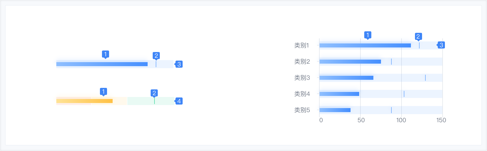
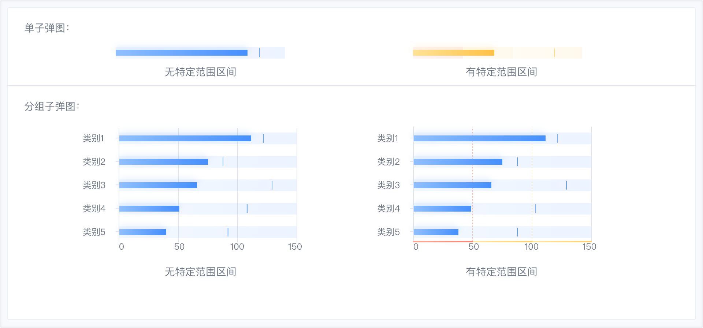
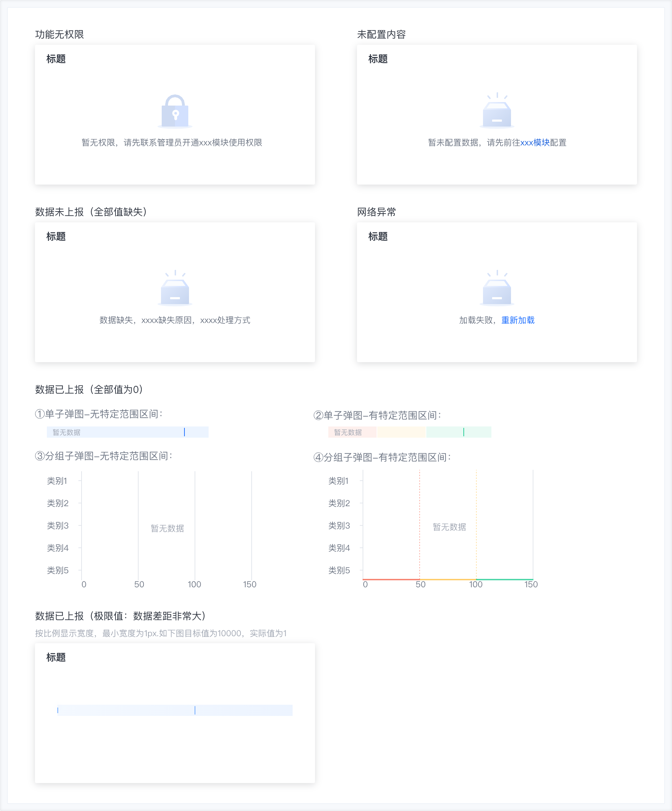
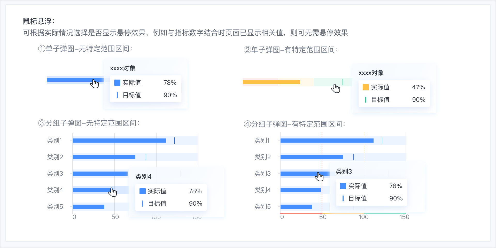

### 使用场景

主要适用于实际值与基准值或计划值的对比，如比较实际使用率和设定的阈值使用率的偏差，比较峰值和平均值的差距等。

### 组件构成

| 序号 | 名称                 | 说明                                                                                                                                                                                         |
| ---- | -------------------- | -------------------------------------------------------------------------------------------------------------------------------------------------------------------------------------------- |
| 1    | 主值                 | 常用于实际值，为图表中最需突出的值。可支持多个主值，并使用堆叠或分组的形式。                                                                                                                 |
| 2    | 次要值               | 常用于目标值和计划值，仅用作与主值比较。                                                                                                                                                     |
| 3    | 背景条               | 用于容纳主值和次要值，增强视觉整体感。当有定性范围区间时，可根据情况去除背景条。                                                                                                             |
| 4    | 定性范围区间（可选） | 当无特定范围区间时，需显示长方形图底用于包裹主值和次要值，增强整体感。范围区间一般设定一个预留值，例如百分比类数据，范围区间预留值为 100% 的长度。当有特定范围区间时，则显示具体的长度数据。 |

### 组件类型

#### 按对象数量分类

| 名称         | 说明                                                                                                                 |
| ------------ | -------------------------------------------------------------------------------------------------------------------- |
| 单对象子弹图 | 仅需显示单对象的值，用于比较两组值（主值和次要值）之间的偏差、差异或差距。常用于概要指标、表格中的可视化信息呈现。   |
| 多对象子弹图 | 需显示多个对象的主值，每个对象与自己的次要值做比较。适用场景如展示不同设备的带宽使用量，以及与设定的最大使用量对比。 |

#### 按有无特定范围区间分类

| 名称           | 说明                                                                               |
| -------------- | ---------------------------------------------------------------------------------- |
| 无特定范围区间 | 背景条为纯色，仅用于增强类别内数据的整体感。                                       |
| 有特定范围区间 | 单对象子弹图中可将背景条改为多段特定范围区间；多对象子弹图可将范围标记在坐标轴中。 |

### 异常情况说明

| 异常情况                               | 展示与处理说明                                                                                       |
| -------------------------------------- | ---------------------------------------------------------------------------------------------------- |
| 功能无权限                             | 展示无权限提示：“暂无权限，请先联系管理员开通 xxx 模块使用权限”。                                    |
| 未配置内容                             | 展示未配置提示：“暂未配置数据，请先前往 xxx 模块配置”，并提供前往对应模块的入口。                    |
| 数据未上报（全部值缺失）               | 展示数据缺失提示，说明缺失原因和处理方式。                                                           |
| 网络异常                               | 展示“加载失败”，并提供“重新加载”操作。                                                               |
| 数据已上报（全部值为 0）：单对象子弹图 | 不绘制主值条，在背景条内展示“暂无数据”；保留目标值标记，有特定范围区间时保留分段背景。               |
| 数据已上报（全部值为 0）：分组子弹图   | 保留坐标轴和分类标签，不绘制主值条，在图表中展示“暂无数据”；有特定范围区间时保留坐标轴中的范围标记。 |
| 数据已上报（极限值：数据差距非常大）   | 按比例显示宽度，最小宽度为 1px。例如目标值为 10000、实际值为 1 时，仍保留实际值的最小可见宽度。      |

### 组件状态

#### 鼠标悬浮

可根据实际情况选择是否显示悬停效果。例如，与指标数字结合时，页面已显示相关值，则可无需悬停效果。

悬停时通过提示信息展示对象或类别名称，以及实际值和目标值。单对象、分组子弹图及有无特定范围区间的样式示例如下。

