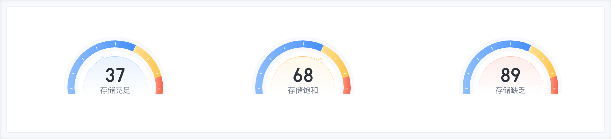
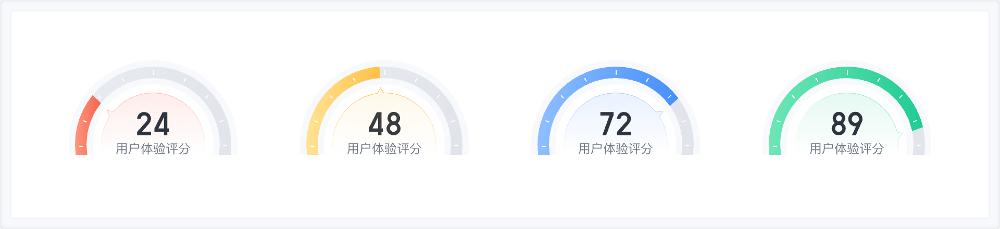
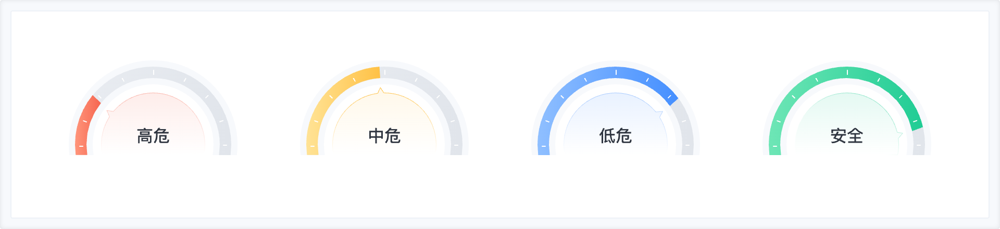

### 使用场景

可清晰地展示出某个指标值所在的范围，也可直观地查看当前任务的完成情况，或者判断某项指标是否在可控制范围内。

### 组件构成

| 序号 | 名称               | 说明                                       |
| ---- | ------------------ | ------------------------------------------ |
| 1    | 表盘               | 多为弧形图案，用不同颜色实时呈现数据状态。 |
| 2    | 标题               | 描述当前图形内容或图形状态。               |
| 3    | 数值（可选）       | 实时呈现内容的具体数值。                   |
| 4    | 指针               | 与表盘状态实时联动，始终指向最新数据点。   |
| 5    | 刻度与数字（可选） | 辅助展示数据的具体维度。                   |

### 组件类型

| 名称       | 说明                                                                       |
| ---------- | -------------------------------------------------------------------------- |
| 表盘状态型 | 弱化指针，常用于指标有明确等级的场景，如存储正常、存储告警、存储达到上限。 |
| 基础数值型 | 常用于通过数据快速呈现当前内容的状态。                                     |
| 状态型     | 常用于直接表达当前内容的状态。                                             |

#### 表盘状态型

#### 基础数值型

#### 状态型

