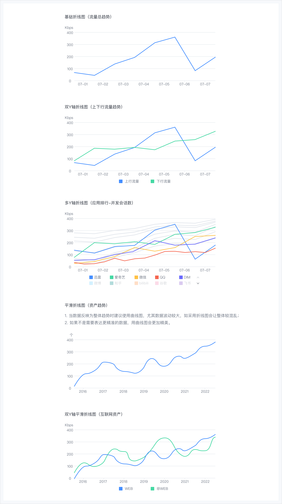

### 选择布局

- 折线用于时间或其他有序分类。分类轴的采样槽等距排列，采样间隔不均且需要表达实际间隔时，使用原生时间轴。
- 多条同单位曲线优先共用 Y 轴。两种单位共用一张图时，标明各自的轴和单位。
- 关注总量及各系列贡献时使用堆叠面积图。需要读取实测拐点时，保留直线连接。

### 表达缺报

缺报点传 `null`，有原因时使用带 `missingReason` 的数据项。保留该采样槽，让底纹或插值标记表达缺报。实际采样为零时传 `0`。
