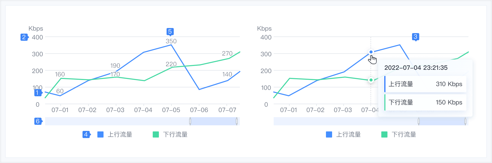
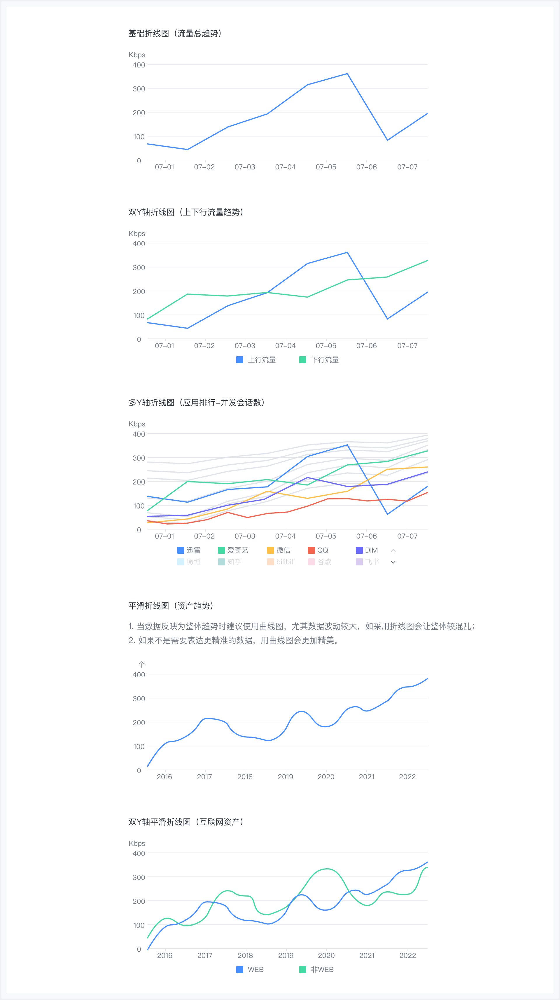
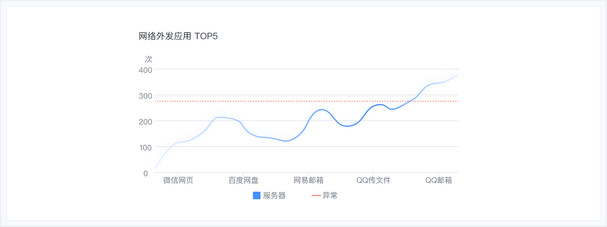
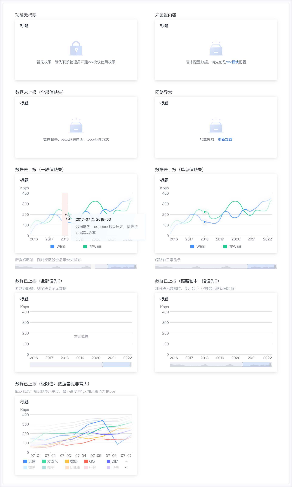

### 使用场景

在折线图中，数据是递增还是递减、增减的速率、增减的规律（周期性、螺旋性等）、峰值等特征都可以清晰地反映出来。所以，折线图常用来分析数据随时间的变化趋势，也可用来分析多组数据随时间变化的相互作用和相互影响。

例如，可用来分析**上下行流量**随时间变化的情况，从而进一步预测未来的流量情况。在折线图中，一般水平轴（X 轴）用来表示时间的推移，并且间隔相同；垂直轴（Y 轴）代表不同时刻的数据大小。

### 组件构成

| 序号 | 名称             | 说明                                                                                                 |
| ---- | ---------------- | ---------------------------------------------------------------------------------------------------- |
| 1    | 图形             | 连接各个数据点的线。                                                                                 |
| 2    | 坐标轴           | X 轴通常为时间，Y 轴通常为数据。                                                                     |
| 3    | 提示信息         | 当鼠标悬停在图形上时，以提示框的形式展示该点的数据，帮助用户快速获取图形的关键数据。                 |
| 4    | 图例（可选）     | 用于解释图表中的分类维度信息。                                                                       |
| 5    | 数据标注（可选） | 对当前的一组数据进行内容标注。                                                                       |
| 6    | 缩略轴（可选）   | 可以缩小以宏观查看数据全貌，也可以放大以微观查看数据片断，同时还可以拖拽观察数据在一定区间内的演变。 |

### 组件类型

#### 基础型

#### 平滑折线图

1. 当数据反映整体趋势时，建议使用曲线图；尤其在数据波动较大时，折线图会让整体显得较凌乱。
2. 如果不需要表达更精确的数据，使用曲线图会更加精美。

#### 图表参考线

在图表上增加参考线，帮助用户更加直观地读取图表信息。

### 异常情况说明

| 异常情况                             | 展示与处理说明                                                                                     |
| ------------------------------------ | -------------------------------------------------------------------------------------------------- |
| 功能无权限                           | 展示无权限提示：“暂无权限，请先联系管理员开通 xxx 模块使用权限”。                                  |
| 未配置内容                           | 展示未配置提示：“暂未配置数据，请先前往 xxx 模块配置”，并提供前往对应模块的入口。                  |
| 数据未上报（全部值缺失）             | 展示数据缺失提示，说明缺失原因和处理方式。                                                         |
| 网络异常                             | 展示“加载失败”，并提供“重新加载”操作。                                                             |
| 数据未上报（一段值缺失）             | 在缺失区段显示断线，悬停时提示缺失的时间范围、原因和解决方案；若含缩略轴，对应区段也显示缺失状态。 |
| 数据未上报（单点值缺失）             | 保留其他数据，缺失点显示断线；缩略轴正常显示。                                                     |
| 数据已上报（全部值为 0）             | 保留坐标轴，在图表中展示“暂无数据”；若含缩略轴，则全段显示无数据。                                 |
| 数据已上报（缩略轴中一段值为 0）     | 所选区间不绘制折线，Y 轴显示默认固定值；缩略轴保留其他区间的数据概览。                             |
| 数据已上报（极限值：数据差距非常大） | 默认按比例显示高度，最小高度为 1px，保证极小值仍可见。                                             |

