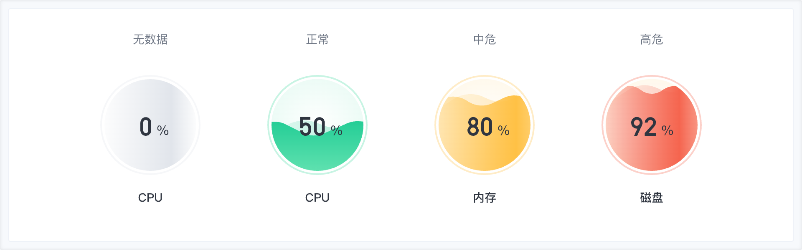
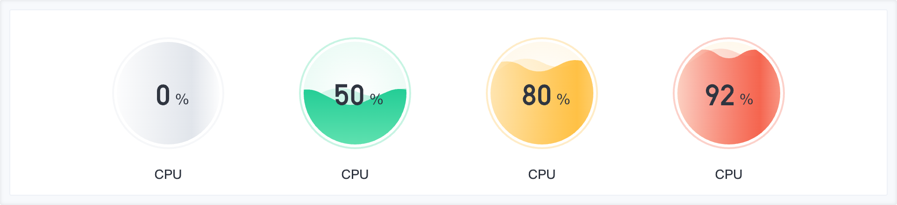

### 使用场景

适用于一组数据的百分比值，或用于展示项目进度的示意图。

### 组件构成

| 序号 | 名称     | 说明                             |
| ---- | -------- | -------------------------------- |
| 1    | 容器     | 通常为圆形，但不局限于圆形。     |
| 2    | 动态水波 | 以动态水波纹的形式展示数据占比。 |
| 3    | 占比数据 | 在容器内直观地呈现数据占比。     |
| 4    | 内容主体 | 展示当前呈现的内容指标。         |

### 组件状态

常见状态及对应的百分比范围如下，可根据业务线场景定义。

| 状态   | 百分比范围 |
| ------ | ---------- |
| 无数据 | 0%         |
| 正常   | 1%–60%     |
| 中危   | 61%–90%    |
| 高危   | 91%–100%   |

### 组件类型

