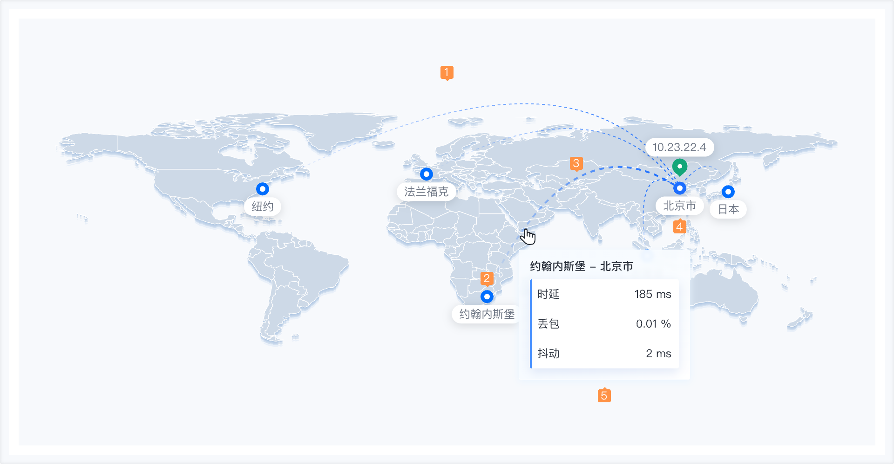
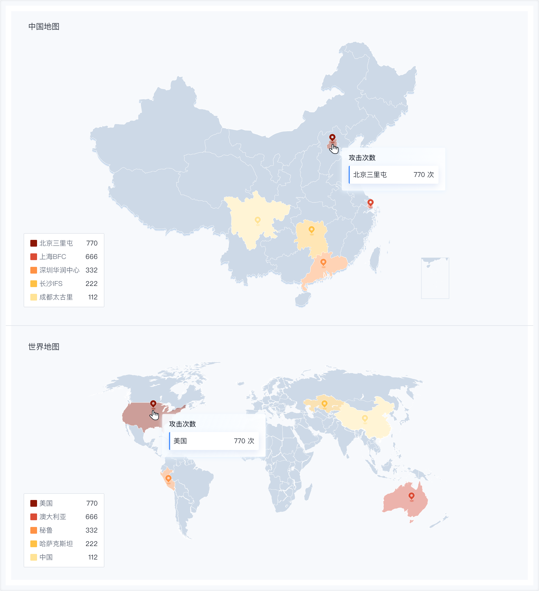
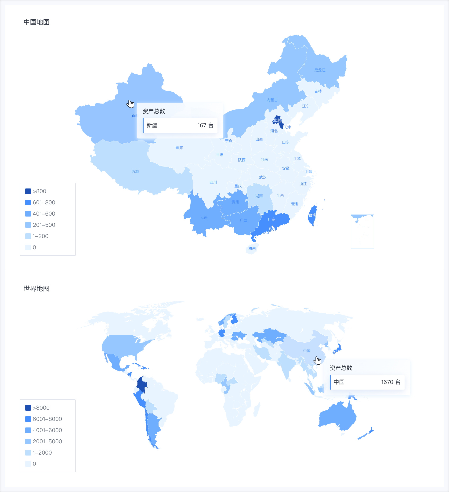
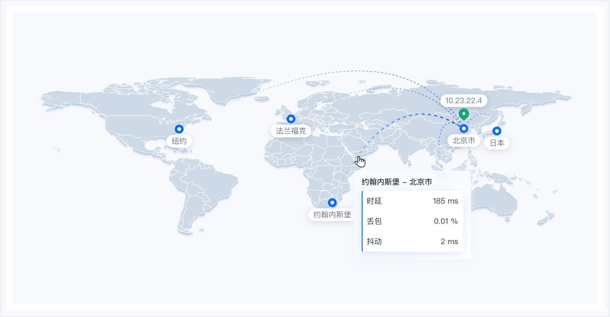

地图主要用于地域区域数据的可视化，可以用于表示数据的大小和分布范围。飞线型地图常用于展示地理节点之间的空间联系、数据流向与轨迹网络。

### 使用场景

适用于空间分布的数据展示，适合带有地理位置信息的数据集，可以展现某个地方单位汇总的流量信息等。也适用于展示起点到终点（OD）的数据流向、网络连接、物流轨迹、业务分布或跨地域的协同关系。

### 组件构成

| 序号 | 名称     | 说明                                                                                 |
| ---- | -------- | ------------------------------------------------------------------------------------ |
| 1    | 地图     | 分为世界地图、中国地图、省份地图等，根据场景需求选择地图类型。                       |
| 2    | 起始节点 | 用于标记数据发出的源头或到达的目标位置（如：城市、服务器节点、网点）。               |
| 3    | 飞线轨迹 | 用于连接两个节点，表示数据流向或业务关系，可通过线条的弧度、粗细、虚实表示不同含义。 |
| 4    | 节点标签 | 显示在节点或飞线附近，用于展示地点名称、IP 地址或具体的业务数值。                    |
| 5    | 提示信息 | 当鼠标悬停在节点或飞线上时，以提示框的形式显示该节点的详细数据或连线的具体流量。     |

### 组件类型

| 名称   | 说明                                                                         |
| ------ | ---------------------------------------------------------------------------- |
| 状态型 | 用不同颜色突出显示几个主要的区域，快速定位、发现风险。                       |
| 密度型 | 用于查看该产品入口或人群密度等块状分布情况。                                 |
| 飞线型 | 用于展示地理节点之间的连接关系、数据流向与轨迹网络，突出起点到终点的关联性。 |

#### 状态型

#### 密度型

#### 飞线型

