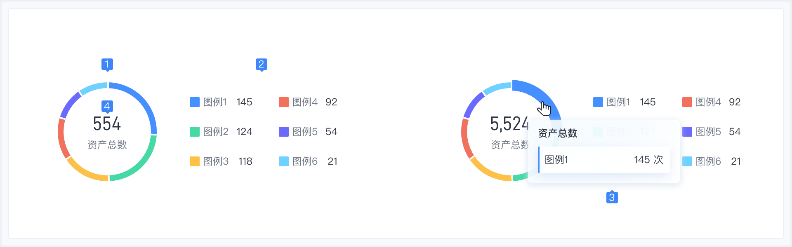
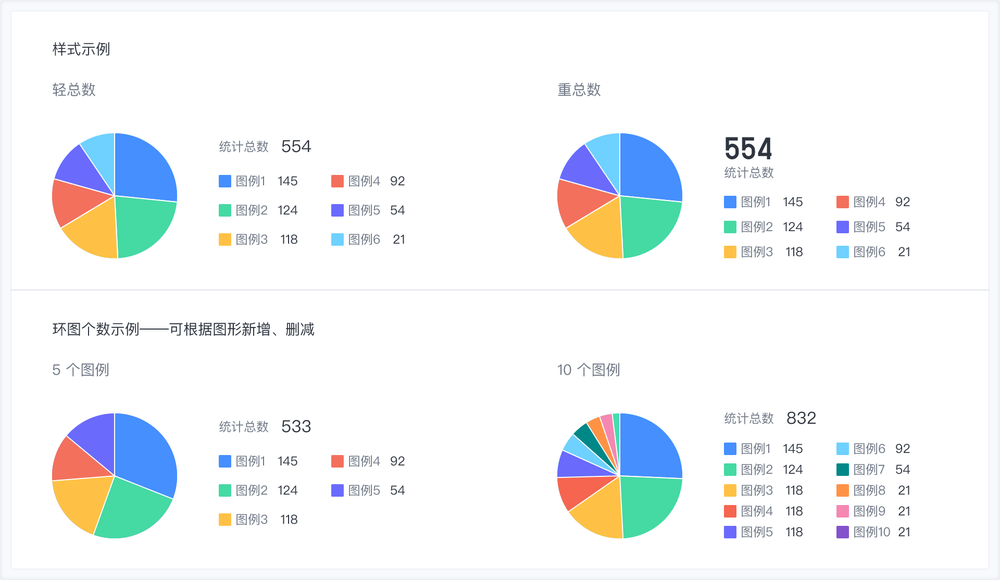
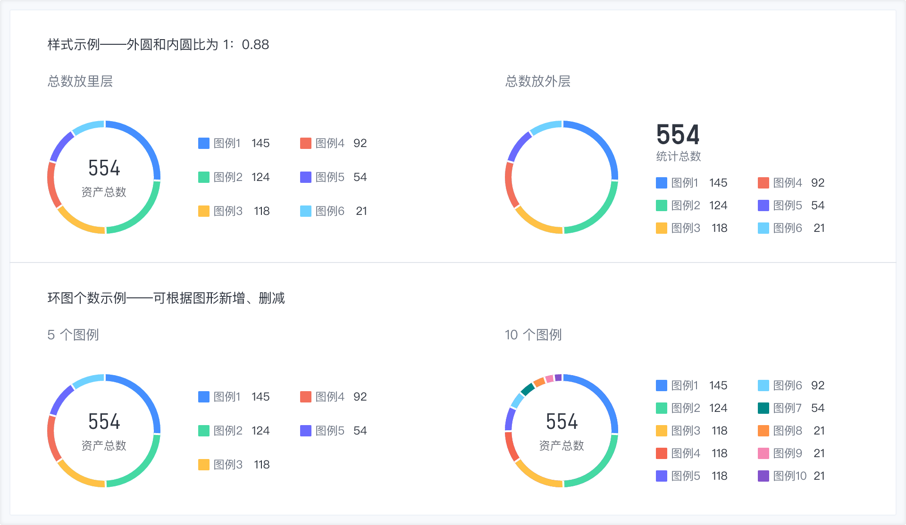
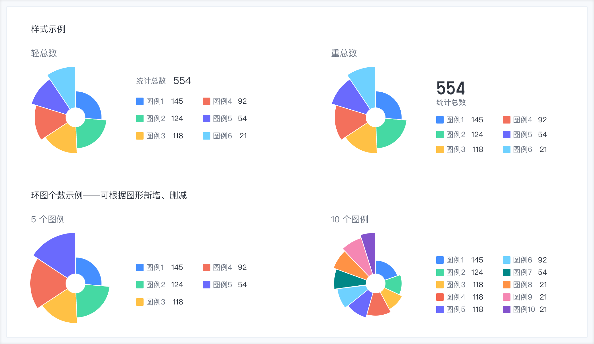
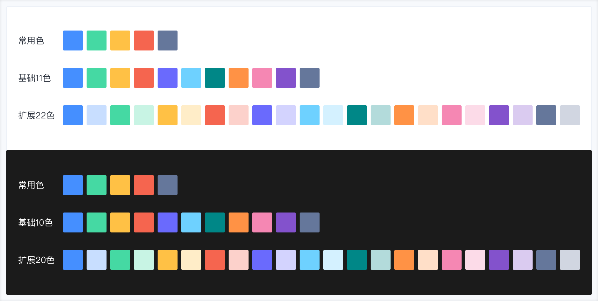
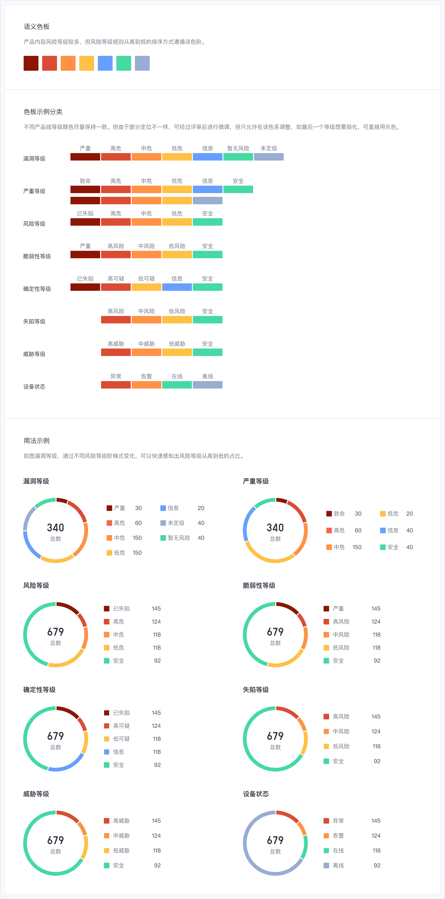

### 使用场景

常用于不超过 10 种分类，且总和为 100% 的分类对比，如安全事件、风险业务、资产分布等。

### 组件构成

| 序号 | 名称             | 说明                                                                                 |
| ---- | ---------------- | ------------------------------------------------------------------------------------ |
| 1    | 图形             | 分为饼图、环形饼图、南丁格尔玫瑰图，根据场景需求选择饼图类型。                       |
| 2    | 图例             | 用于解释图表中的分类维度信息。                                                       |
| 3    | 提示信息         | 当鼠标悬停在图形上时，以提示框的形式展示该点的数据，帮助用户快速获取图形的关键数据。 |
| 4    | 统计总数（可选） | 数据总数，可根据场景放置。                                                           |

### 组件类型

| 名称           | 说明                                                                       |
| -------------- | -------------------------------------------------------------------------- |
| 基础饼图       | 饼图通过弧度的大小来对比数据。                                             |
| 环形饼图       | 由饼图将中间区域挖空，视觉上比饼图更加轻量，通过区块弧长对比数据。         |
| 南丁格尔玫瑰图 | 通过圆弧的半径长短表示数据的大小，比基础饼图和环形饼图展示更多的分类数据。 |

#### 基础饼图

#### 环形饼图

#### 南丁格尔玫瑰图

### 异常情况说明

| 异常情况                             | 展示与处理说明                                                                                 |
| ------------------------------------ | ---------------------------------------------------------------------------------------------- |
| 功能无权限                           | 展示无权限提示：“暂无权限，请先联系管理员开通 xxx 模块使用权限”。                              |
| 未配置内容                           | 展示未配置提示：“暂未配置数据，请先前往 xxx 模块配置”，并提供前往对应模块的入口。              |
| 数据未上报（全部值缺失）             | 展示数据缺失提示，说明缺失原因和处理方式。                                                     |
| 网络异常                             | 展示“加载失败”，并提供“重新加载”操作。                                                         |
| 数据未上报（单点值缺失）             | 保留图形和其他分类数据，在对应图例处标记“数据缺失”；悬停时通过提示信息说明缺失原因及解决方案。 |
| 数据已上报（全部值为 0）             | 使用灰色环形展示，总数与各图例数值均显示为 0。                                                 |
| 数据已上报（极限值：数据差距非常大） | 默认按比例显示区块宽度，最小宽度为 1px，保证极小值仍可见。                                     |

### 色彩建议

#### 分类色板

灰色可作为“其他”色使用，或者正常搭配使用。

#### 语义色板

用于风险等级的配色等。

