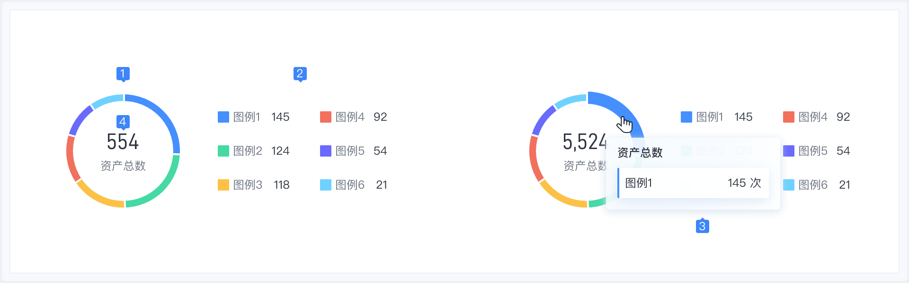
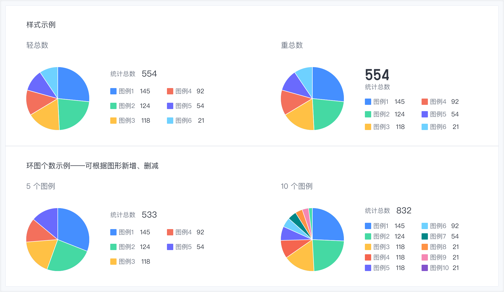
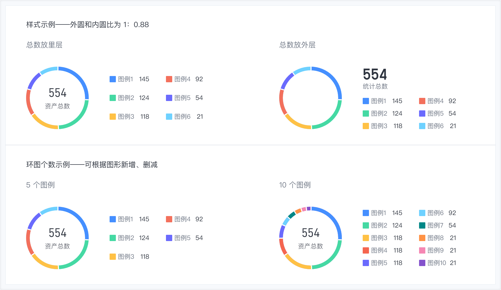
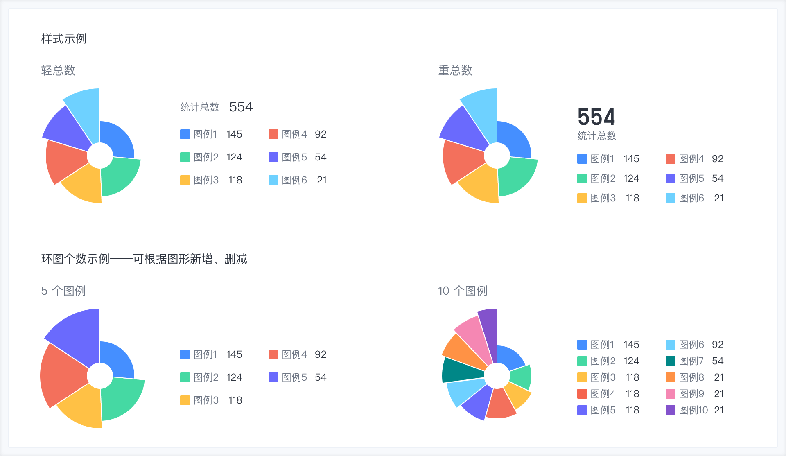
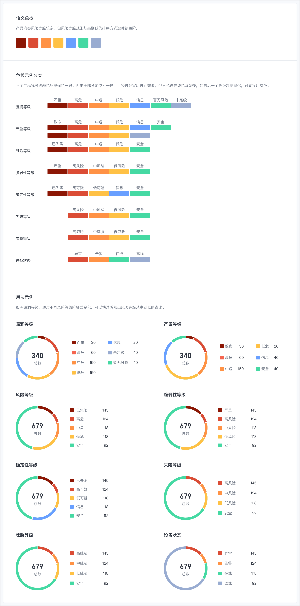

### 使用场景

用于展示同一总体内各分类的占比，如安全事件、风险业务、资产分布等。传入各分类的原始数量即可，无需将数据预先换算成总和为 100 的百分数。建议分类数量保持精简；这不是组件限制，多分类可参考多列图例示例。

### 选择合适的示例

| 示例                           | 展示内容                                                                    |
| ------------------------------ | --------------------------------------------------------------------------- |
| 实心饼图、环形图、玫瑰图       | 形态、轻/重总数，以及全零、缺失、空态、加载和模拟重试；环形图另支持中心摘要 |
| 多列图例、图例自定义 Formatter | 自动分列与分页，以及业务计算的数值和百分比                                  |
| 九宫格对齐、形态与自适应       | 整体对齐、容器宽高、分类数量和可见性切换                                    |
| 卡片环形图、轻量卡片饼图       | 业务卡片组合与紧凑布局                                                      |
| 大尺寸：基础形态与加载         | 实心、环形、面积模式玫瑰图及原生加载遮罩                                    |
| 大尺寸：风险分布               | 分类绑定语义颜色，扇区与图例使用一致的业务提示                              |
| 大尺寸：多层装饰环图           | 显式 `series` 组合的手动布局                                                |

只传 `data` 时保留 1.0.0 的原生布局与默认效果。设置 `layoutMode="auto"` 或声明 `align` 启用自动布局；显式 auto 模式下，样式变化不会间接切换布局。设置 `layoutMode="native"` 使用原生配置路径。完整几何配置仍优先，具体条件见 API。

统计合计、百分比分母、风险阈值和缺失原因由业务提供；自动布局负责图形、标题及图例的位置和尺寸。全零保留中性占位环，缺失项保留图例且不绘制扇区；空态 UI、模拟加载和重试由示例外层控制。

九宫格对齐示例使用 `IxButton` 组成 3×3 控件，选中项采用 primary 样式并暴露 `aria-pressed`；按钮及容器边框跟随 iDux 明暗主题。切换对齐位置保留图表实例。

### 组件构成

| 序号 | 名称             | 说明                                                                                 |
| ---- | ---------------- | ------------------------------------------------------------------------------------ |
| 1    | 图形             | 分为实心饼图、环形饼图、南丁格尔玫瑰图，根据场景需求选择饼图类型。                   |
| 2    | 图例             | 用于解释图表中的分类维度信息。                                                       |
| 3    | 提示信息         | 当鼠标悬停在图形上时，以提示框的形式展示该点的数据，帮助用户快速获取图形的关键数据。 |
| 4    | 统计总数（可选） | 数据总数，可根据场景放置。                                                           |

### 组件类型

| 名称           | 说明                                                                       |
| -------------- | -------------------------------------------------------------------------- |
| 基础饼图       | 饼图通过弧度的大小来对比数据。                                             |
| 环形饼图       | 由饼图将中间区域挖空，视觉上比饼图更加轻量，通过区块弧长对比数据。         |
| 南丁格尔玫瑰图 | 支持 `roseType: 'radius'` 和 `'area'` 两种模式；分类较多时仍应控制可读性。 |

- 基础饼图

- 环形饼图

- 南丁格尔玫瑰图

文中的图片是设计示意，当前可运行效果以示例页为准。

### 语义色板

用于风险等级的配色等。

### 与其他图表的对比

对比柱状图

- 饼图主要是展示分类之间的占比情况。
- 而柱状图主要展示各个分类数量、大小的对比。
