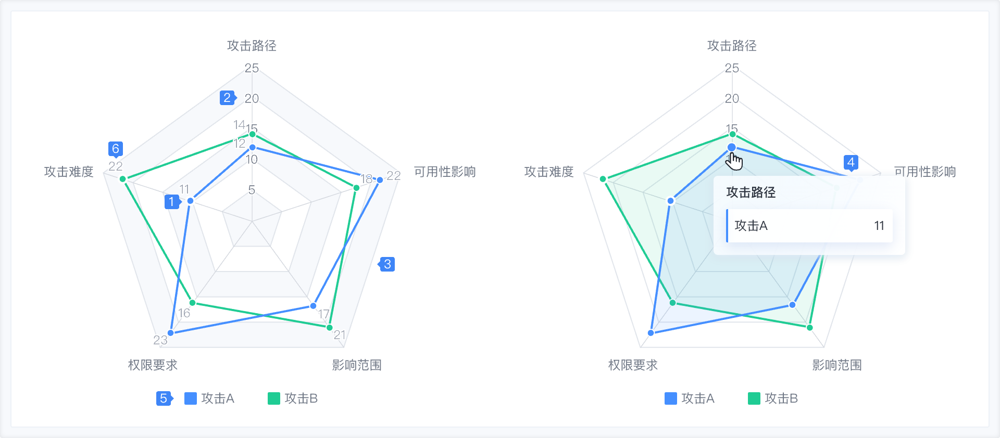
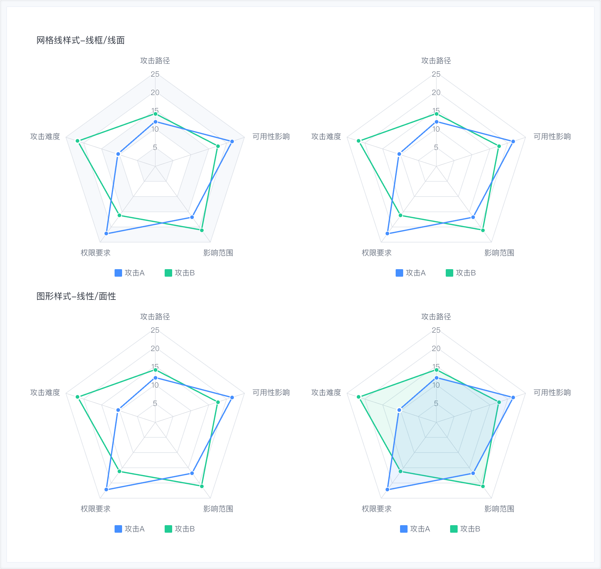

### 使用场景

通过雷达图，用户可以直观地了解各个变量之间的关系，一目了然地看出各个变量之间的相对强弱关系，从而反映单个对象的整体状况，同时也可以对多个对象进行倾向对比。常用于倾向分析或重点把握。

一般来说，雷达图的维度以 4–6 个为宜。当变量数量很多时，雷达图可能会变得复杂且难以阅读，因此在使用时需要注意不要包含过多的变量。

### 组件构成

| 序号 | 名称             | 说明                                                                                 |
| ---- | ---------------- | ------------------------------------------------------------------------------------ |
| 1    | 图形             | 点位分布在坐标轴上，通过线段进行连接。                                               |
| 2    | 极坐标轴         | 各极轴对应不同分类，沿轴的刻度标明数值。                                             |
| 3    | 网格线           | 用于构成图表画板。                                                                   |
| 4    | 提示信息         | 当鼠标悬停在点位上时，以提示框的形式展示该点的数据，帮助用户快速获取图形的关键数据。 |
| 5    | 图例（可选）     | 当对象为两个及以上时，通过图例指明不同的对象。                                       |
| 6    | 数据标注（可选） | 对当前变量对应的具体数值进行标注。                                                   |

### 组件类型

| 类型       | 样式                                                                       |
| ---------- | -------------------------------------------------------------------------- |
| 网格线样式 | 线框或线面。                                                               |
| 图形样式   | 线性或面性。线性样式通过线段连接点位；面性样式在连接点位的基础上填充区域。 |

