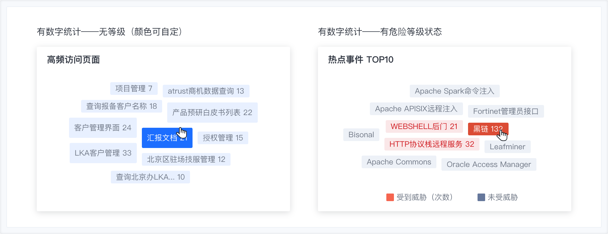
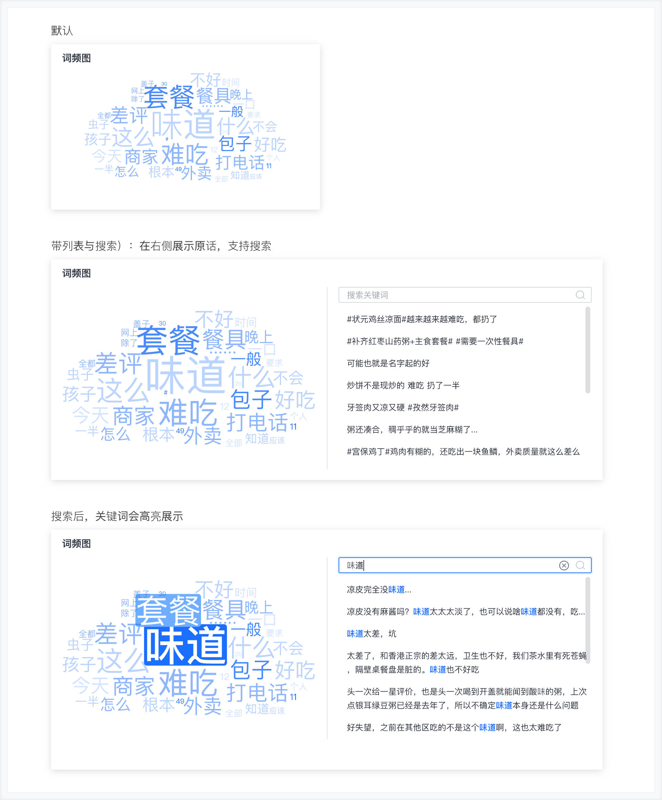
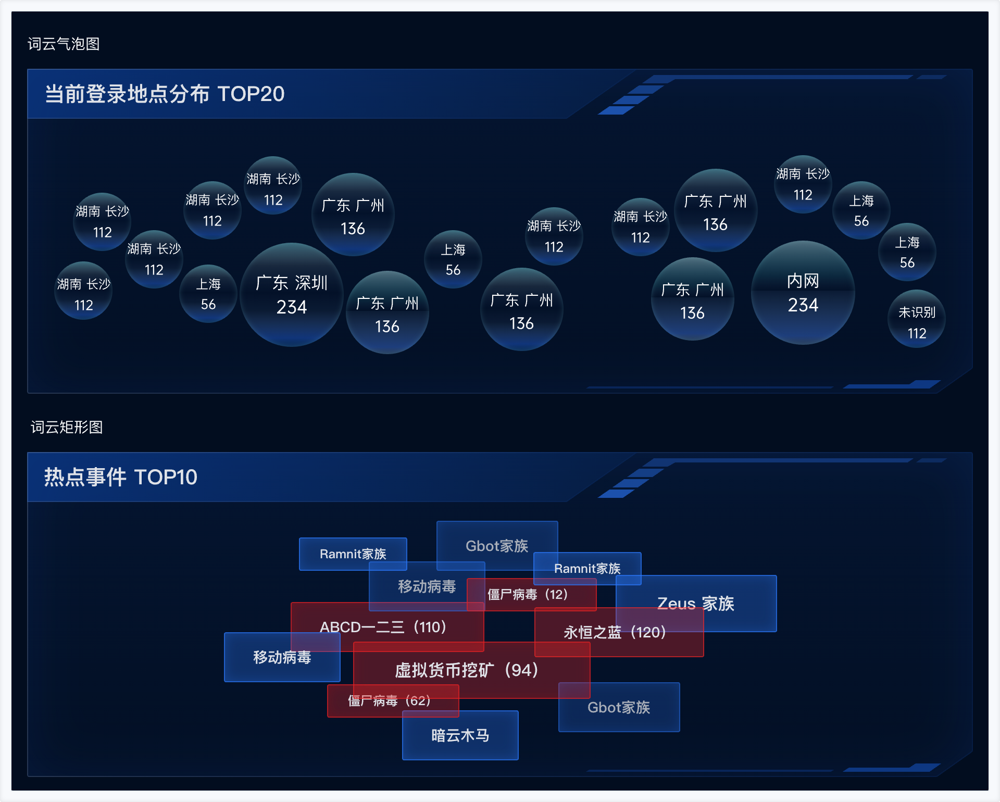

词云图是将词汇按照频率高低显示为不同大小而形成的可视化图表，适用于统计文本中出现词汇的规模大小，强调词汇的重要性和相关性。

### 使用场景

用于对描述性文案做统计与展示，并支持搜索，可适用于以下场景：

- 可视化统计：用于总览页、列表的可视化统计，通常统计某事件、对象的数量。
- 大屏展示：用于在可视化大屏中展示某事件、对象的数量。

### 组件构成

| 序号 | 名称         | 说明                             |
| ---- | ------------ | -------------------------------- |
| 1    | 文字         | 展示具体的文字内容。             |
| 2    | 图形         | 一般为矩形，也可由其他形状组成。 |
| 3    | 图例（可选） | 用于解释图表中的分类维度信息。   |

### 组件类型

| 名称       | 说明                                                                                       |
| ---------- | ------------------------------------------------------------------------------------------ |
| 基础型     | 展示词语的字体样式、字体粗细、最小字号、最大字号、词语距离组件的边距，以及图形形状等样式。 |
| 可搜索型   | 结合原话列表搜索关键词，并高亮匹配内容。                                                   |
| 大屏专用型 | 通过词云气泡图或矩形图，在可视化大屏中展示事件、对象的数量。                               |

#### 基础型

有数字统计时，可按无等级和有危险等级状态两种方式展示。无等级时颜色可自定义；有危险等级状态时，可通过颜色及图例区分分类。

#### 可搜索型

默认展示词频图。需要展示原话时，可在词频图右侧增加原话列表和搜索框，支持关键词搜索；搜索后，关键词高亮展示。

#### 大屏专用型

